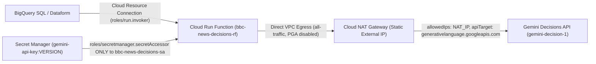

# google-decision-api-demo

Practical demo and accuracy/latency benchmark of the **Google Gemini Decisions API** (`gemini-decision-1`) for structured text classification inside **BigQuery**, powered by **BigQuery Remote Functions**, **Cloud Run** (Python 3.15 + `uv`), and **Dataform**.

Evaluates articles from `bigquery-public-data.bbc_news.fulltext` across all three Decisions API question types in a single forward pass:

| Question Key | Type | Output Field | Purpose |
| :--- | :--- | :--- | :--- |
| `category_pred` | `choice` | `category_pred`, `category_confidence`, `route` | 5-class editorial routing (`tech`, `sport`, `business`, `politics`, `entertainment`); routes `< 0.75` confidence to `human_review` |
| `is_market_moving` | `noul` | `is_market_moving_prob` | Probability of material corporate, M&A, regulatory, or macroeconomic news |
| `editorial_urgency` | `score` | `editorial_urgency_score` | Ordered 0–3 editorial urgency rubric |

---

## Architecture & Cloud Run-Only API Key Isolation



To guarantee that the Gemini API key **can only be used by this Cloud Run service** (and never from outside GCP, another project workload, or unrelated APIs), [deploy.sh](deploy.sh) enforces four fail-closed layers:

1. **Dedicated Least-Privilege Runtime Service Account**: Creates `bbc-news-decisions-sa@<PROJECT_ID>.iam.gserviceaccount.com` with zero project-level roles and refuses the shared `*-compute@developer.gserviceaccount.com` SA.
2. **Exclusive Secret Manager Access & Version Pinning**: Grants `roles/secretmanager.secretAccessor` solely to `bbc-news-decisions-sa`, removes any legacy Compute Engine default SA binding, verifies the secret IAM policy via `jq`, and mounts an immutable numeric secret version (`GEMINI_API_KEY=${SECRET_NAME}:${SECRET_VERSION}`).
3. **Static Egress IP via Direct VPC Egress + Cloud NAT (`PGA=false`)**: Creates a custom VPC subnet (`/24`) with **Private Google Access disabled** (`--no-enable-private-ip-google-access`) and routes `--vpc-egress="all-traffic"` through Cloud NAT bound to a reserved static external IP (`NAT_IP`). Disabling Private Google Access prevents calls to `generativelanguage.googleapis.com` from bypassing Cloud NAT over Google's internal network.
4. **GCP API Keys Restriction (`apikeys.googleapis.com`)**: Locks the API key strictly to `--api-target=service=generativelanguage.googleapis.com` and `--allowed-ips="${NAT_IP}"`, verified fail-closed with `gcloud services api-keys describe`.

See [SECURITY.md](SECURITY.md) for the complete threat model and application-level hardening controls.

---

## Prerequisites

- Google Cloud project with billing enabled
- [`gcloud`](https://cloud.google.com/sdk/docs/install) authenticated (`gcloud auth login` and application/project configured)
- [`bq`](https://cloud.google.com/bigquery/docs/bq-command-line-tool), [`jq`](https://jqlang.org/), and [`uv`](https://docs.astral.sh/uv/) installed locally

---

## Quickstart Deployment

### Option A: Managed Cloud Run-Locked Key (Recommended)

Leave `GEMINI_API_KEY` unset. `deploy.sh` creates all network/NAT/IAM resources, provisions a dedicated GCP API key restricted exclusively to `generativelanguage.googleapis.com` and `NAT_IP`, stores it in Secret Manager, deploys Cloud Run, and registers the BigQuery Remote Function:

```bash
export PROJECT_ID="your-gcp-project-id"
./deploy.sh
```

### Option B: Existing GCP-Managed API Key (Fail-Closed)

If you supply `GEMINI_API_KEY`, it **must** belong to a GCP project accessible via `gcloud services api-keys` (`API_KEY_PROJECT_ID`, defaulting to `PROJECT_ID`) so `deploy.sh` can apply and verify IP + API restrictions. Unmanaged keys are rejected fail-closed.

```bash
export PROJECT_ID="your-gcp-project-id"
export API_KEY_PROJECT_ID="your-gcp-project-id"   # or key-owning project ID
export API_KEY_ID="optional-key-uuid"             # optional for faster lookup
export GEMINI_API_KEY="your-managed-api-key"
./deploy.sh
```

### Configurable Environment Variables

| Variable | Default | Description |
| :--- | :--- | :--- |
| `PROJECT_ID` | `gcloud config` project | Target GCP project ID |
| `REGION` | `us-central1` | Cloud Run, VPC subnet, Router, and Cloud NAT region |
| `BQ_LOCATION` | `US` | BigQuery dataset & connection location (must match `bigquery-public-data`) |
| `FUNCTION_NAME` | `bbc-news-decisions-rf` | Cloud Run service name |
| `BQ_DATASET` | `bbc_news_eval` | BigQuery dataset for remote function and evaluation tables |
| `BQ_CONNECTION_ID` | `gemini-decisions-conn` | BigQuery `CLOUD_RESOURCE` connection ID |
| `SECRET_NAME` | `gemini-api-key` | Secret Manager secret name |
| `RUNTIME_SA_NAME` | `bbc-news-decisions-sa` | Dedicated Cloud Run service account ID |
| `VPC_SUBNET_RANGE` | `10.128.0.0/24` | Direct VPC Egress CIDR (`/26` or larger required) |
| `MAX_BATCHING_ROWS` | `20` | BigQuery Remote Function `max_batching_rows` option |

---

## Running the Evaluation

### Dataform Pipeline

Update `defaultProject` and `vars.cloudRunEndpoint` in [workflow_settings.yaml](workflow_settings.yaml), then compile and run the Dataform DAG:

- Source declaration: [definitions/sources/bbc_news_fulltext.sqlx](definitions/sources/bbc_news_fulltext.sqlx)
- Remote function operation: [definitions/functions/evaluate_article.sqlx](definitions/functions/evaluate_article.sqlx)
- Staging table + assertions: [definitions/staging/bbc_news_decisions_50.sqlx](definitions/staging/bbc_news_decisions_50.sqlx)
- Analytical marts: `eval_accuracy_by_category`, `eval_routing_summary`, `top_market_moving_articles`, `top_urgent_articles`

---

## Security & Release Validation

Run all offline pre-release validations (secret/history scan, ignore-file checks, `uv.lock` verification, `bash -n` / `shellcheck`, deployment hardening assertions, and Python unit + security tests):

```bash
./scripts/verify_security.sh
```

Audit a live deployed GCP environment to confirm Cloud Run SA, VPC egress, disabled Private Google Access, Cloud NAT static IP, API key restrictions, Secret Manager IAM, and private Cloud Run IAM:

```bash
PROJECT_ID="your-gcp-project-id" ./scripts/verify_security.sh --live
```

---

## Cleanup

Cloud NAT gateways and reserved external IP addresses incur small hourly GCP charges while active. Remove deployed resources when finished testing:

```bash
export PROJECT_ID="your-gcp-project-id"
export REGION="us-central1"

bq rm -r -f -d "${PROJECT_ID}:bbc_news_eval"
bq rm --connection --location=US --project_id="${PROJECT_ID}" gemini-decisions-conn
gcloud run services delete bbc-news-decisions-rf --region="${REGION}" --project="${PROJECT_ID}" --quiet
gcloud secrets delete gemini-api-key --project="${PROJECT_ID}" --quiet
gcloud compute routers nats delete bbc-decisions-nat --router=bbc-decisions-router --region="${REGION}" --project="${PROJECT_ID}" --quiet
gcloud compute routers delete bbc-decisions-router --region="${REGION}" --project="${PROJECT_ID}" --quiet
gcloud compute addresses delete bbc-decisions-nat-ip --region="${REGION}" --project="${PROJECT_ID}" --quiet
gcloud compute networks subnets delete bbc-decisions-egress-subnet --region="${REGION}" --project="${PROJECT_ID}" --quiet
gcloud compute networks delete bbc-decisions-egress-vpc --project="${PROJECT_ID}" --quiet
gcloud iam service-accounts delete "bbc-news-decisions-sa@${PROJECT_ID}.iam.gserviceaccount.com" --project="${PROJECT_ID}" --quiet
```

*(Delete or rotate the API key in **APIs & Services > Credentials** if no longer needed.)*

---

## License

Licensed under the **GNU Affero General Public License v3.0 (AGPL-3.0)** — see [LICENSE](LICENSE).
